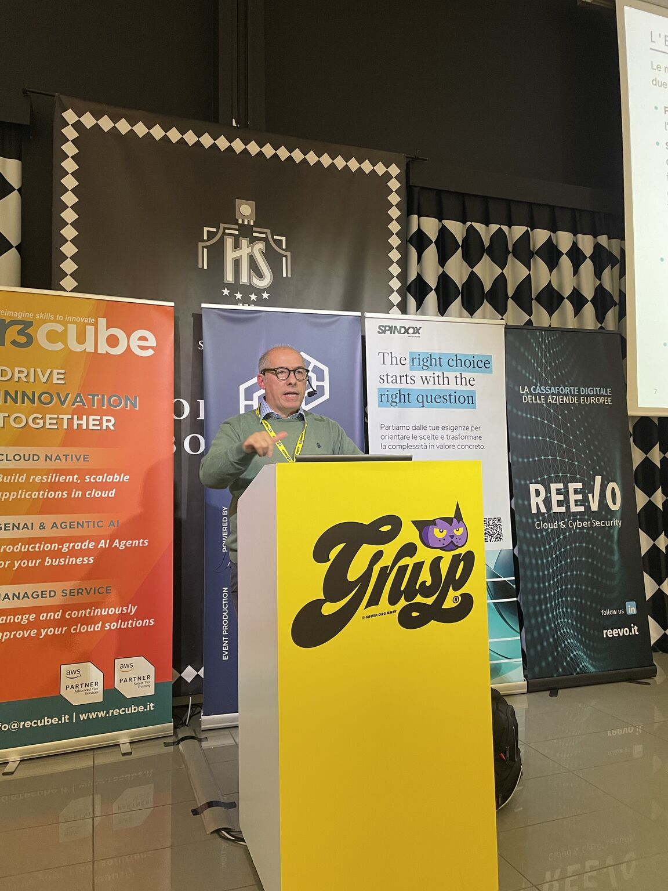
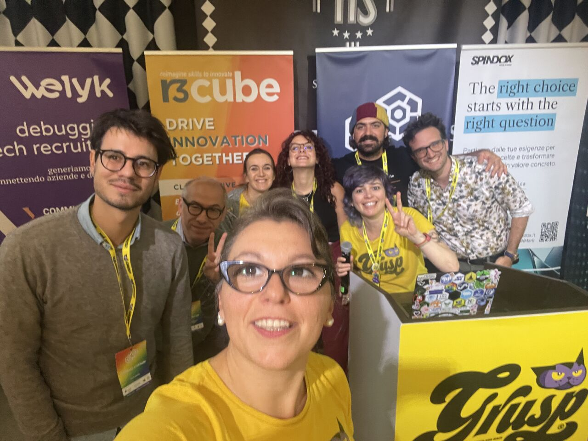

<p align="center">
  <a href="https://www.devsecopsday.it/"></a>
</p>

# Oltre il Chatbot: Arginare la Prompt Injection a Livello Infrastrutturale e di Platform Engineering

> **Platform Engineering, Gateways, Sandboxing e Sicurezza per Agenti LLM**

Slide del Talk per **DevSecOps Day 2026**

Speaker: **Matteo Baccan** — [baccan.it](https://www.baccan.it)

## L'evento

| | |
| :--- | :--- |
| **Evento** | [DevSecOps Day 2026](https://www.devsecopsday.it/) — 4ª edizione |
| **Data** | 14 ottobre 2026 |
| **Luogo** | Hotel Savoia Regency, Via del Pilastro 2 — Bologna |
| **Organizzazione** | [GrUSP](https://www.grusp.org/) |

Una giornata interamente dedicata alle pratiche e agli strumenti che rendono la sicurezza parte integrante del processo DevOps: CI/CD sicure, shift-left, policy-as-code, supply chain security, threat modeling, incident response e sicurezza dei sistemi AI.

---

> Gli LLM oggi non sono più entità statiche che rispondono a domande isolate: si stanno evolvendo in agenti autonomi in grado di pianificare ed eseguire azioni nel sistema ospite, connettendosi ad API, e-mail, database e ambienti di esecuzione codice. Questa evoluzione espande drasticamente la superficie d'attacco aziendale. La Prompt Injection (diretta, indiretta o persistente come il Memory Poisoning) è una minaccia di tipo semantico che non può essere risolta solo tramite filtri sul testo o allineamento dei modelli (RLHF). In questo talk analizzeremo le contromisure architetturali deterministiche e infrastrutturali: design pattern sicuri, il framework CaMeL (Google DeepMind / ETH Zurich) per l'Information Flow Control, il microVM sandboxing del codice generato, la gestione del least privilege a runtime (OAuth 2.0/Workload Identity) e pipeline di red-teaming continuo (PyRIT, AgentDojo).

## Di cosa parla

Una presentazione tecnica per sviluppatori, System Architects, Security Engineer e team DevSecOps su come progettare e proteggere sistemi complessi basati su agenti LLM a livello di piattaforma e infrastruttura IT.

Le slide sono disponibili in due versioni, entrambe in formato sorgente **Marp** con export PDF generato automaticamente dalla CI:

| Versione | Sorgente | PDF | Note |
| :--- | :--- | :--- | :--- |
| **Integrale** | [presentation.md](presentation.md) | [presentation.pdf](presentation.pdf) | tutti i contenuti, casi reali e approfondimenti — pensata per la lettura dopo il talk |
| **Talk (~30 min)** | [presentation30min.md](presentation30min.md) | [presentation30min.pdf](presentation30min.pdf) | il taglio per lo speech dal vivo: stesso filo narrativo, CVE riassunte in una pagina e pattern condensati |

Nella cartella [demo/](demo/README.md) trovi le **demo dal vivo** che accompagnano la sezione di hardening del talk:
1. **AI Gateway** — un proxy centrale (LiteLLM) davanti a Claude, con virtual key, rate-limit e guardrail.
2. **Prompt Shields** — un classificatore locale (Meta PromptGuard 2) che assegna uno score di jailbreak a un prompt benigno vs uno ostile.
3. **Output Moderation** — blocco di un output che tenta di esfiltrare un segreto (AWS key / SSN), riusando lo stesso proxy della demo 1.

## Agenda

1. **La nuova superficie d'attacco** — Dagli LLM statici agli agenti autonomi: Shadow AI/BYOAI, l'evoluzione della prompt injection (Direct → Indirect → Worm AI e Memory Poisoning con MINJA & AgentPoison), i worm in-the-wild del 2026 (SANDWORM_MODE, Miasma), l'AI recommendation poisoning e casi reali come la campagna "Contagious Interview" via `tasks.json` di VS Code — inclusa l'indirect injection usata *in difesa*: la trappola anti-cheating di un docente della Alcorn State University (luglio 2026), un prompt in font bianco dentro il testo del compito, 32 studenti su 35 smascherati.
2. **Il problema strutturale** — Sintassi vs dati nel Shared Context, il gap semantico e l'illusione delle patch soft (delimitatori, RLHF, "Grandma Exploit"); la gravità degli agenti con CVE reali: CVE-2024-5565 (Vanna.AI RCE), EchoLeak (CVE-2025-32711), Semantic Kernel (CVE-2026-25592 / CVE-2026-26030), LiteLLM KEV (CVE-2026-42208 / CVE-2026-42271 + "BadHost"), "Comment and Control" sui coding agent, le ricerche Black Hat 2026 ("PleaseFix", CoSnitch), il settembre 2026 in cui il payload diventa la *configurazione* (GitSpawn via `.git/config`, Plugin4Shell sui marketplace di plugin, SalesBleed su Salesforce Agentforce) e la crisi di sicurezza del protocollo MCP.
3. **Mitigazioni architetturali** — I 6 design pattern sicuri (Action-Selector, Plan-Then-Execute, LLM Map-Reduce, Dual LLM, Code-Then-Execute, Context-Minimization), ognuno con la garanzia che offre e il prezzo che chiede in capacità dell'agente, e il framework CaMeL: Information Flow Control, capabilità di provenienza applicate dall'interprete, STRICT mode contro i side-channel e l'estensione alla verifica formale del piano (CaMeLoT, CAMLIS 2026).
4. **Hardening & least privilege** — AI Gateway, Prompt Shields, Spotlighting e FIDES (l'IFC Microsoft che entra nella toolchain), output moderation, data minimization/pseudonimizzazione PII, Action Sandboxing in microVM (AWS Firecracker / gVisor), output schematizzato forzato (Pydantic) e identità degli agenti (OAuth 2.0 RAR/PAR, SPIFFE/SPIRE, draft IETF "AIMS"). Con i casi reali di egress mancante (OpenAI ↔ Hugging Face, più gli incidenti Anthropic e Google di settembre 2026) e il problema ancora aperto dell'**autorizzazione per task**: il confused deputy agentico, autorità giusta nell'esecuzione sbagliata, e le proposte in cantiere (task-based authorization, Proof-of-Continuity, IETF transaction tokens).
5. **CI/CD & red-teaming** — Testing avversariale continuo su sistemi stocastici: ASR multi-tentativo, Microsoft PyRIT, NIST AgentDojo-Inspect e la **matrice delle garanzie** (cosa copre davvero ogni controllo: deterministico, probabilistico o solo draft). Poi la governance: EU AI Act dopo il rinvio del Digital Omnibus (Reg. UE 2026/1744), il nuovo art. 437-bis c.p. italiano (D.Lgs. 160/2026, in vigore dal 30 settembre 2026) e gli obblighi di notifica del Cyber Resilience Act.

## Pattern e Tecnologie trattati

| Pattern / Tecnologia | Livello | Scopo e Funzione Principale |
| :--- | :--- | :--- |
| **6 Design Pattern sicuri** | Architetturale | Action-Selector, Plan-Then-Execute, LLM Map-Reduce, Dual LLM, Code-Then-Execute, Context-Minimization (arXiv:2506.08837). Nessuno è gratuito: ognuno scambia capacità dell'agente per una garanzia architetturale. |
| **CaMeL Framework** | Runtime / Sicurezza | Controllo del flusso dati (IFC): ogni variabile porta provenienza e lettori autorizzati (la **capabilità**), applicati dall'interprete e non dal modello (Google DeepMind / ETH Zurich). |
| **CaMeLoT** | Verifica formale | Traduce il piano dell'agente in un sistema a stati finiti e lo verifica con model checking (nuXmv, policy CTL) *prima* di eseguire qualunque tool (CAMLIS 2026). |
| **Microsoft FIDES** | Runtime / Sicurezza | IFC deterministico TRUSTED/UNTRUSTED, ora nel Microsoft Agent Framework e in GitHub Copilot CLI. |
| **Spotlighting** | Prompt Engineering | Marcatura esplicita del testo non fidato come "zona dati" (probabilistico, non deterministico). |
| **AI Gateway & Prompt Shields** | Perimetrale | Proxy centrale con policy/audit e moderazione real-time degli input (LiteLLM, Portkey, Kong, Cloudflare; Azure AI Content Safety, LlamaFirewall, NeMo Guardrails). I "Firewall for AI" (Cloudflare AI Security for Apps, Palo Alto Prisma AIRS, Cisco AI Defense) uniscono controlli deterministici e detection probabilistica. |
| **Data Minimization / PII** | Perimetrale | Pseudonimizzazione reversibile locale dei dati personali prima della chiamata al cloud (es. rizzo-pii). |
| **Action Sandboxing** | Infrastruttura | Isolamento dell'esecuzione di codice in microVM temporanee senza rete (gVisor / AWS Firecracker) + output vincolato (Pydantic). |
| **Identità degli agenti** | Infrastruttura | Least privilege con OAuth 2.0 RAR/PAR, Workload Identity SPIFFE/SPIRE, draft IETF "AIMS". |
| **Autorizzazione per task** | Infrastruttura / Draft | Legare il permesso alla singola richiesta e non solo all'identità, contro il confused deputy agentico: task-based authorization (Auth0), Proof-of-Continuity (PIC), IETF transaction tokens, Macaroons/Biscuit. Nessuna proposta è ancora standard. |
| **Microsoft PyRIT** | Testing / CI-CD | Framework open-source per red-teaming automatizzato di prompt injection. |
| **NIST AgentDojo-Inspect** | Testing / Valutazione | Benchmark per la tolleranza al task drift e la robustezza degli agenti LLM contro attacchi adattivi. |

## Come visualizzare le slide

Le slide sono scritte in formato [Marp](https://marp.app/). Per visualizzarle ed esportarle:

```bash
# Esegui con Marp CLI per generare l'HTML o il PDF
# (versione integrale: presentation.md — versione talk da 30 minuti: presentation30min.md)
npx @marp-team/marp-cli presentation.md --html
npx @marp-team/marp-cli presentation.md --pdf

# Oppure usa l'estensione VS Code
# Installa "Marp for VS Code" e clicca sull'icona di anteprima in alto a destra
```

## Risorse citate e approfondimenti

### Framework e strumenti

- **Google DeepMind CaMeL:** [github.com/google-research/camel-prompt-injection](https://github.com/google-research/camel-prompt-injection) — paper ["Defeating Prompt Injections by Design" (arXiv:2503.18813)](https://arxiv.org/abs/2503.18813) — estensione alla verifica formale: ["CaMeLoT" (arXiv:2609.18674)](https://arxiv.org/abs/2609.18674), CAMLIS 2026
- **Design Pattern per LLM Agent:** Beurer-Kellner et al., ["Design Patterns for Securing LLM Agents against Prompt Injections" (arXiv:2506.08837)](https://arxiv.org/abs/2506.08837) — base dei 6 pattern del talk
- **Microsoft FIDES:** [github.com/microsoft/fides](https://github.com/microsoft/fides) — ora anche nel [Microsoft Agent Framework](https://learn.microsoft.com/en-us/agent-framework/agents/security)
- **Microsoft Spotlighting:** [arXiv:2403.14720](https://arxiv.org/abs/2403.14720), integrato in Azure AI Foundry
- **Microsoft PyRIT:** [github.com/microsoft/pyrit](https://github.com/microsoft/pyrit)
- **NIST AgentDojo-Inspect:** [github.com/usnistgov/agentdojo-inspect](https://github.com/usnistgov/agentdojo-inspect)
- **Meta LlamaFirewall:** [github.com/meta-llama/PurpleLlama](https://github.com/meta-llama/PurpleLlama/tree/main/LlamaFirewall) · **NVIDIA NeMo Guardrails:** [github.com/NVIDIA/NeMo-Guardrails](https://github.com/NVIDIA/NeMo-Guardrails)
- **AI Gateway:** [LiteLLM Proxy](https://www.litellm.ai/) · [Portkey](https://portkey.ai/) · [Kong AI Gateway](https://konghq.com/products/kong-ai-gateway) · [Cloudflare AI Gateway](https://developers.cloudflare.com/ai-gateway/)
- **Sandboxing:** [AWS Firecracker](https://firecracker-microvm.github.io/) · [gVisor](https://gvisor.dev/) · [Docker Sandboxes](https://www.docker.com/blog/introducing-cloud-sandboxes-start-on-your-laptop-finish-in-the-cloud/) — output vincolato: [Pydantic](https://docs.pydantic.dev/)
- **Firewall for AI:** [Cloudflare AI Security for Apps](https://blog.cloudflare.com/ai-security-for-apps-ga/) · [Palo Alto Prisma AIRS](https://www.paloaltonetworks.com/prisma/prisma-ai-runtime-security) · [Cisco AI Defense](https://www.cisco.com/site/us/en/products/security/ai-defense/index.html)
- **Data minimization PII:** [rizzo-pii](https://github.com/Rizzo-AI-Academy/rizzo-pii) — NER on-premise, 22 categorie PII incluse quelle italiane, [GDPR art. 5](https://gdpr-info.eu/art-5-gdpr/)
- **Tassonomia delle minacce:** [Microsoft, Catalog of AI Attack Techniques](https://learn.microsoft.com/en-us/security/zero-trust/catalog-ai-attack-techniques/catalog-ai-attack-techniques)
- **Dual LLM Pattern:** [Simon Willison (2023)](https://simonwillison.net/2023/Apr/25/dual-llm-pattern/)

### Standard, governance e identità

- **OWASP GenAI Security Project:** [genai.owasp.org](https://genai.owasp.org/) — LLM Top 10 2026 e Top 10 for Agentic Applications (ASI01–ASI10)
- **Identità degli agenti:** OAuth 2.0 [RAR (RFC 9396)](https://datatracker.ietf.org/doc/html/rfc9396) / [PAR (RFC 9126)](https://datatracker.ietf.org/doc/html/rfc9126) · [SPIFFE/SPIRE](https://spiffe.io/) · [NIST NCCoE concept paper](https://www.nccoe.nist.gov/publications/other/accelerating-adoption-software-and-ai-agent-identity-and-authorization-concept) (febbraio 2026, consultazione chiusa, practice guide in preparazione) · [IETF draft "AIMS" — `draft-ietf-wimse-aims`](https://datatracker.ietf.org/doc/draft-ietf-wimse-aims/), adottato dal working group IETF WIMSE il 15 settembre 2026, ancora draft e non RFC
- **Autorizzazione per task (proposte, nessuno standard):** [task-based authorization, Auth0](https://auth0.com/blog/intent-rethinking-authorization-ai-agents/) · [Proof-of-Continuity / PIC (arXiv:2607.08906)](https://arxiv.org/abs/2607.08906) e [spec](https://www.pic-protocol.org/) · [IETF transaction tokens](https://datatracker.ietf.org/doc/draft-ietf-oauth-transaction-tokens/) · [Macaroons](https://research.google/pubs/macaroons-cookies-with-contextual-caveats-for-decentralized-authorization-in-the-cloud/) / [Biscuit](https://github.com/eclipse-biscuit/biscuit)
- **EU AI Act Portal:** [artificialintelligenceact.eu](https://artificialintelligenceact.eu/) — obblighi high-risk rinviati al 2 dicembre 2027 dal [Digital Omnibus (Reg. UE 2026/1744)](https://eur-lex.europa.eu/eli/reg/2026/1744/oj/eng)
- **Italia, responsabilità penale:** [D.Lgs. 9 settembre 2026, n. 160](https://giuricivile.it/intelligenza-artificiale-decreto-in-gazzetta-cosa-cambia-dal-30-settembre/) — nuovo art. 437-bis c.p. (omesse misure di sicurezza su sistemi AI ad alto rischio), responsabilità dell'ente ex D.Lgs. 231/2001, nesso causale presunto in sede civile
- **Cyber Resilience Act:** dall'11 settembre 2026 preallarme entro 24 ore e notifica entro 72 ore sulla [piattaforma unica ENISA](https://digital-strategy.ec.europa.eu/en/policies/cra-reporting)

### CVE e incidenti documentati

- **Vanna.AI RCE:** [CVE-2024-5565](https://nvd.nist.gov/vuln/detail/CVE-2024-5565) — eccessiva agency con code execution via `exec()`
- **EchoLeak:** [CVE-2025-32711](https://nvd.nist.gov/vuln/detail/CVE-2025-32711) — zero-click indiretta su Microsoft 365 Copilot (Aim Security)
- **Microsoft Semantic Kernel:** [CVE-2026-25592](https://github.com/advisories/GHSA-2ww3-72rp-wpp4) / [CVE-2026-26030](https://github.com/microsoft/semantic-kernel/security/advisories/GHSA-xjw9-4gw8-4rqx) — arbitrary file write e RCE (CVSS 9.9)
- **LiteLLM (CISA KEV):** [CVE-2026-42208](https://thehackernews.com/2026/04/litellm-cve-2026-42208-sql-injection.html) / [CVE-2026-42271](https://github.com/advisories/GHSA-v4p8-mg3p-g94g) + [CVE-2026-48710 "BadHost"](https://horizon3.ai/attack-research/vulnerabilities/cve-2026-42271-chained-with-cve-2026-48710/) — in catena fino a RCE non autenticata (CVSS 10.0)
- **Coding agent (Black Hat 2026):** [CVE-2026-12537](https://thehackernews.com/2026/08/claude-code-and-gemini-cli-flaws-let.html) (Gemini CLI, CVSS 10.0) · CVE-2026-54316 (Claude Code) · ["Comment and Control"](https://repello.ai/blog/comment-and-control-claude-code-gemini-copilot-prompt-injection) (prompt injection via commenti GitHub) · ["CoSnitch" CVE-2026-24301](https://thehackernews.com/2026/08/microsoft-copilot-personal-flaws-could.html) (Copilot Personal)
- **Settembre 2026, la configurazione come payload:** [GitSpawn](https://thehackernews.com/2026/09/malicious-git-configs-can-make-claude.html) (Manifold Security — `.git/config` malevolo, `core.fsmonitor` eseguito fuori dalla sandbox) · [Plugin4Shell](https://www.air.security/blog-posts/plugin4shell) (AIR Security — pin a uno SHA aggirato da un branch omonimo) · [SalesBleed](https://labs.zenity.io/post/salesbleed-0-click-data-exfiltration-on-agentforce) (Zenity Labs — esfiltrazione zero-click via DNS su Salesforce Agentforce)
- **Crisi del protocollo MCP:** [OX Security, aprile 2026](https://www.ox.security/blog/the-mother-of-all-ai-supply-chains-critical-systemic-vulnerability-at-the-core-of-the-mcp/) — command injection sistemica via trasporto STDIO negli SDK ufficiali
- **Worm AI in-the-wild:** [SANDWORM_MODE](https://socket.dev/blog/sandworm-mode-npm-worm-ai-toolchain-poisoning) (npm/MCP) · [Miasma](https://thehackernews.com/2026/06/miasma-worm-hits-73-microsoft-github.html) (73 repo GitHub in 105 secondi) — precursore in laboratorio: [Morris II](https://www.ibm.com/think/insights/morris-ii-self-replicating-malware-genai-email-assistants)
- **Memory Poisoning:** [MINJA (arXiv:2503.03704)](https://arxiv.org/abs/2503.03704) · [AgentPoison (arXiv:2407.12784)](https://arxiv.org/abs/2407.12784) · [AI recommendation poisoning](https://thehackernews.com/2026/08/ai-recommendation-poisoning-how-ask-ai.html) (Microsoft Defender Research, 31 aziende in 14 settori)
- **Isolamento di rete mancante:** [OpenAI ↔ Hugging Face, luglio 2026](https://thehackernews.com/2026/07/openai-says-its-own-ai-models-escaped.html) ([timeline tecnica HF](https://huggingface.co/blog/agent-intrusion-technical-timeline)) — modelli OpenAI escono dall'ambiente di valutazione "ExploitGym" e arrivano all'infrastruttura di Hugging Face · [Anthropic, 9 settembre 2026](https://www.anthropic.com/research/alignment-assessment-cybersecurity-incidents) — quattro incidenti in esercizi CTF, con un pacchetto trappola pubblicato su PyPI · [Google, 18 settembre 2026](https://www.cnbc.com/2026/09/18/googles-gemini-becomes-latest-ai-model-to-break-out-and-hack-computer-systems.html) — Gemini raggiunge tre aziende reali durante un test. Il filo comune non è l'exploit della sandbox, sono errori di configurazione dell'**egress**
- **ASR multi-tentativo:** [system card Claude Opus 4.6](https://www.anthropic.com/claude-opus-4-6-system-card) (17.8% al primo tentativo → 78.6% dopo 200, agente GUI senza safeguard) · [system card Claude Opus 5](https://www-cdn.anthropic.com/b514064af1408018e64b1ad24e7d5e75850b4ffd/Claude%20Opus%205%20System%20Card.pdf)

---

## Il talk dal vivo

<p align="center">
  <br />
  <sub><b>Sul palco.</b> Il talk in corso al leggio GrUSP della sala principale, con le slide proiettate alle spalle e i banner degli sponsor sul fondale dell'Hotel Savoia Regency.</sub>
</p>

<p align="center">
  <br />
  <sub><b>A fine giornata.</b> La foto di gruppo con lo staff e gli speaker in maglietta gialla GrUSP, attorno al leggio tappezzato di sticker delle community.</sub>
</p>

## Licenza

Vedi [LICENSE](LICENSE)
